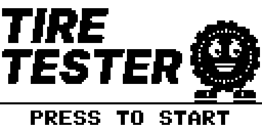
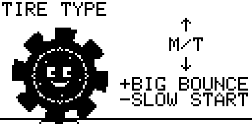
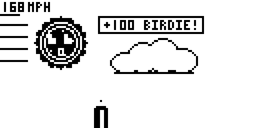

# Tire Tester



A tire with a face, a rev counter and a ramp. Pick your tire, set the pressure,
tip the ramp, rev him up and let go at the right moment — then see how far he
bounces, rolls and flies.

245 Different Combinations to test

By **jaychugstein** · MIT License · Arduboy FX / FX-C (uses the FX flash chip).

**Play it in your browser:** https://jaychugstein.github.io/Tire-Tester/ (works on phones too)

 

## Controls

| Button | What it does |
|---|---|
| Up / Down | Change the setting on each setup screen |
| Outer button | Next screen · at the start line, hold to rev and let go to launch · after a run, go again |
| Inner button | Back one screen · after a run, back to the title |

## How a run works

1. **Sound** — on or off (remembered).
2. **Tire type** — five tires, each with its own tread and its own strengths.
3. **Tire pressure** — 15 to 45 PSI; watch the tire squash or round out.
4. **Ramp angle** — 15° to 60°.
5. **Start line** — hold the outer button to rev. Let go when the needle is in the
   white notch in the red zone for a **PERFECT LAUNCH**. Too early is weak, too late
   still gets most of the speed.

That's 350 different setups (5 tires × 7 pressures × 10 ramp angles).

### Tires

| Tire | Good at | Bad at |
|---|---|---|
| Summer | Fastest start | Lowest bounce |
| Winter | Soft landings (keeps speed) | Slow start |
| All Season | Rolls the farthest | — all round |
| A/T | Bouncy | Shorter roll |
| M/T | Biggest bounce | Slowest start |

Low pressure grips better and lands softer but stops sooner; high pressure bounces
more and rolls farther but grips less. Low ramps keep your speed, steep ramps give
big air.

## What's out there

Everything on the course helps you:

**On the ground:** speed bumps, boost arrows, kicker ramps, trampolines, tire stacks
and pickup trucks.

**In the air:** hubcaps and birds (+100 each), boost rings and blimps to bounce on.

Your score is distance plus pickups plus a bonus for your launch. The best score is
saved.

## Install

Load `release/TireTester.arduboy` with any FX-aware uploader (for example the
Arduboy Web Flasher or the Arduboy-Python-Utilities), or the `.hex` together
with `release/TireTester-fxdata.bin`.

The game is built with `ARDUBOY_NO_USB` to save space, like most cart games:
to upload something else afterwards, press reset when the uploader asks.

## Building from source

The sketch is in `TireTester/` and needs the **Arduboy2**, **ArduboyFX** and
**ArduboyTones** libraries. The game fills the Arduboy almost completely, so the
source sets a few size-saving compiler options itself (top of `TireTester.ino`).

* **Arduino IDE:** open `TireTester/TireTester.ino`, pick an Arduboy board,
  compile, then upload `TireTester/fxdata/fxdata.bin` as the FX data.
* **Command line:** `./build.sh` (edit the paths at the top) → `build/TireTester.hex`.

All the art is drawn by Python scripts in `art/` (needs numpy, scipy and Pillow)
and packed into the FX data:

```
cd art
python3 title_text.py && python3 sprites.py && python3 tread.py
python3 psi_types.py && python3 tach.py && python3 hero.py
python3 fxpack.py      # writes TireTester/fxdata/fxdata.bin and TireTester/fxdata.h
```

`title_text.py` uses the Inter Black Italic font (SIL Open Font License).

## Browser version

`docs/` is a small web page that runs the real game file in the
[Ardens](https://github.com/tiberiusbrown/Ardens) emulator (MIT, by Peter Brown).
It's served by GitHub Pages from the `docs` folder.

## License

MIT — see [LICENSE](LICENSE). Uses the Arduboy2 (BSD 3-Clause), ArduboyFX (CC0) and
ArduboyTones (BSD 3-Clause) libraries; `TireTester/font.h` is the Arduboy2 font.
